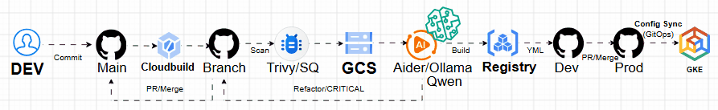

# AI-DevSecOps
A CICD integration implementations with AI, Security and Quality validation mechanisms

## Architecture

## Component
- [x] GitHub
- [x] GCP - Cloud-Build
- [x] SonarQube
- [x] Trivy
- [x] Aider
- [x] Ollama
- [x] GPU - L4VM
- [x] Monitoring
- [x] Registry
- [x] GKE

